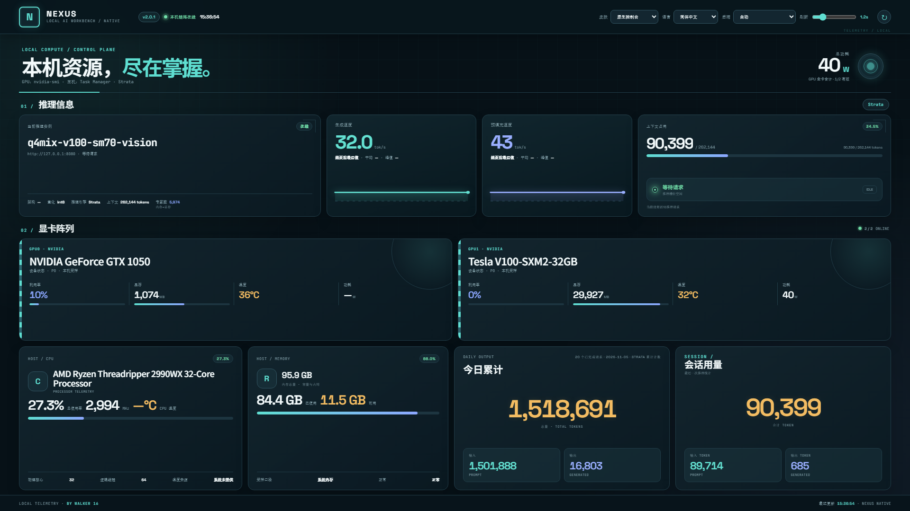
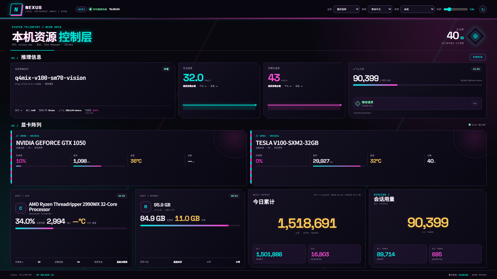
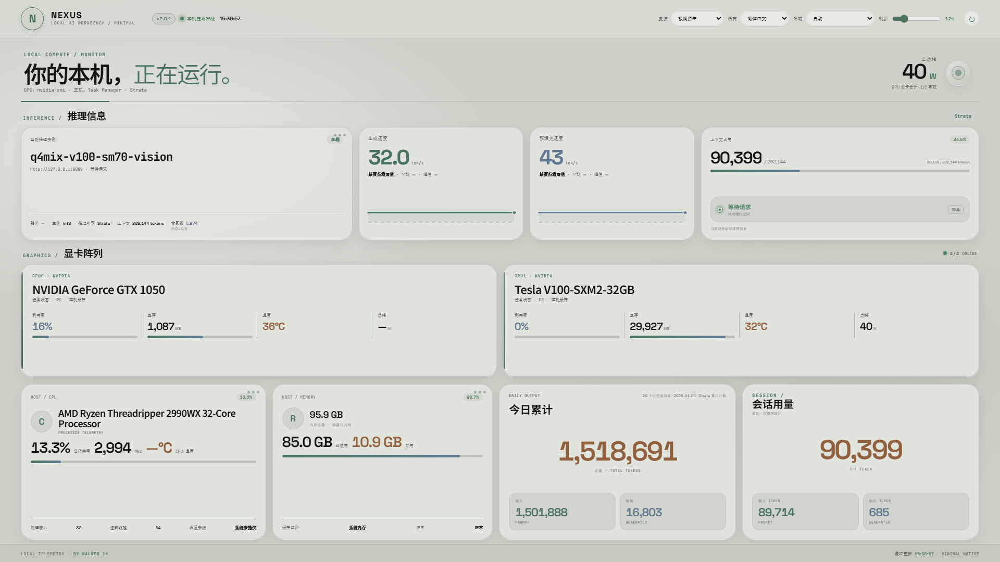
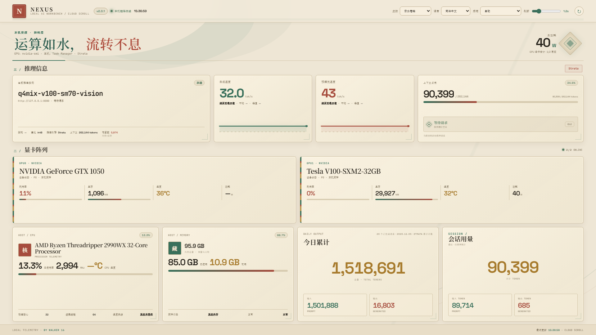
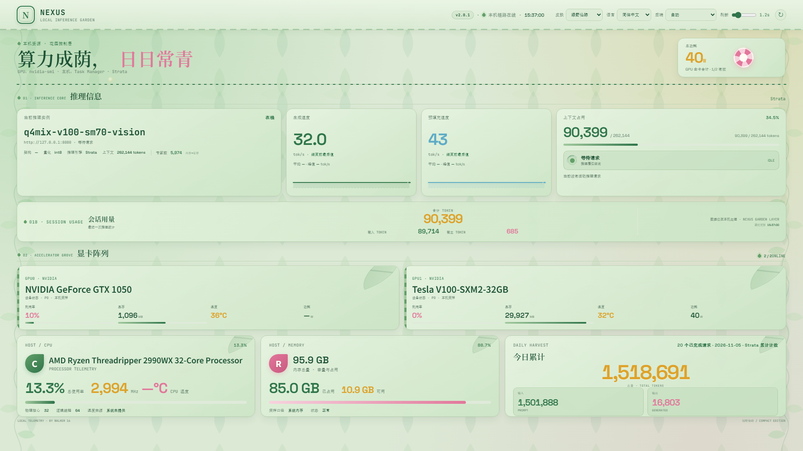

# Local AI Workbench / （老板视察喜欢的）本地AI工作台

Zero-dependency, browser-based local monitoring dashboard for GPU, token
generation speed (llama.cpp / LM Studio), power, CPU, memory, and daily
token totals.

零依赖的本地监控面板，基于浏览器运行，实时显示 GPU 状态、token 生成速度（llama.cpp / LM Studio）、功耗、CPU、内存以及每日 token 总量。

## 20261109更新
- 增加安全措施，防止未经授权的API-KEY获取；
- 新增了vLLM的后端接入；
- 没有啥BUG需要修复（欢迎提交）。

## 20261109 Update
- Added security measures to prevent unauthorized access to API keys.
- Added vLLM backend integration.
- No bugs need fixing (bug reports are welcome).

## 20261105更新
- NEW！更新全新的皮肤界面，现在可以自由缩放而不需要滚动，一页就能显示所有信息！（见下图）🐳
- 新增了MAYA的后端接入；
- 没有啥BUG需要修复（欢迎提交）。

## 20261105 Update
- NEW! Updated all skin interfaces: they now scale freely without scrolling, displaying all information on a single page!(SEE EXAMPLE BELOW) 🐳
- Added MAYA backend integration.
- No bugs needed fixing (bug reports are welcome).

## 20261009更新
- 推理面板加了「峰值」：生成速度和预填充速度除了平均，还会显示本次任务跑到的最高值（和平均同一个统计窗口，换模型或开新任务时一起清零），方便看性能上限；
- 修了个隐蔽的 BUG：切到英文再切回简体中文，界面文字现在能完整还原（之前会残留英文）；
- BUG修复。

## 20261009 Update

- Added a **peak** number next to the average for both generation and prompt speed. Same window as the average (they reset together when the model changes or a new task starts), so you can read the ceiling against the mean — handy when tuning.
- Fixed a sneaky one: switching back to 简体中文 now restores the whole UI (it used to stay English).
- Bug fixes.

## 20261007更新
- 加入了绿野仙踪皮肤，更护老板眼；
- 加入了最近大火大热的Strata后端接入（它有Monitor，但老板需要看中文的时候可以看这个😃）；
- BUG修复。

## 20261007 Update

- Added the **Wizard of Oz** skin — easier on the boss's eyes.
- Added integration with **Strata**, the backend that's been all the rage lately. (It has a Monitor, but when the LAOBAN(boss) needs to read things in Chinese, this one does the trick 😃)
- Bug fixes.

## Requirements / 环境要求

- **Node.js >= 18** – auto-installed by `scripts/start.bat` (Windows) or
  `scripts/start.sh` (macOS/Linux) if not already present.
- Optional: NVIDIA GPU + driver, llama.cpp server, or LM Studio server for
  real inference data.

  Node.js >= 18 – 若未安装，scripts/start.bat（Windows）或 scripts/start.sh（macOS/Linux）会自动安装。
可选：NVIDIA GPU + 驱动、llama.cpp 服务或 LM Studio 服务，用于获取真实推理数据。

## Install / 安装

- Simply tell your Agent I want this and copy link to it.
- 跟你的AI粘贴链接说，我要这个.

## Start / 启动方式

### Windows

```bat
scripts\start.bat
```

### macOS / Linux

```bash
bash scripts/start.sh
```

### OR ASK YOUR AI TO STARTUP IS OK / 或者问你的AI怎么启动也是可以的哦

Open <http://127.0.0.1:4173> after startup. 启动浏览器输入地址即可启动工作台。

## Skins / 皮肤

本工作台提供了5套皮肤 / 5 SKINS OFFERED IN THIS WORKBENCH 

| Skin            | EFFECT                   |
|-----------------|-----------------------|
| Native Console  |  |
| Neon Matrix     |  |
| Minimal Native  |  |
| Cloud Scroll    |  |
| Emerald Garden  |  |

## Environment Variables / 环境变量

| Variable       | Default                  |
|----------------|--------------------------|
| `PORT`         | `4173`                   |
| `LLAMA_URL`    | `http://127.0.0.1:8080` |
| `LMSTUDIO_URL` | `http://127.0.0.1:1234` |

## Data Sources (priority order) / 数据来源

1. `nvidia-smi` – GPU name, utilisation, memory, temp, power, fan, P-state
2. LM Studio `server-logs/` – per-request prompt/eval tokens, daily totals
3. LM Studio `conversations/` – fallback per-conversation stats
4. llama.cpp `/metrics` or `/slots` – prompt & generation tok/s
5. Demo data – clearly labelled when no real source is reachable

The server binds to `127.0.0.1` only. No data leaves the local machine.
